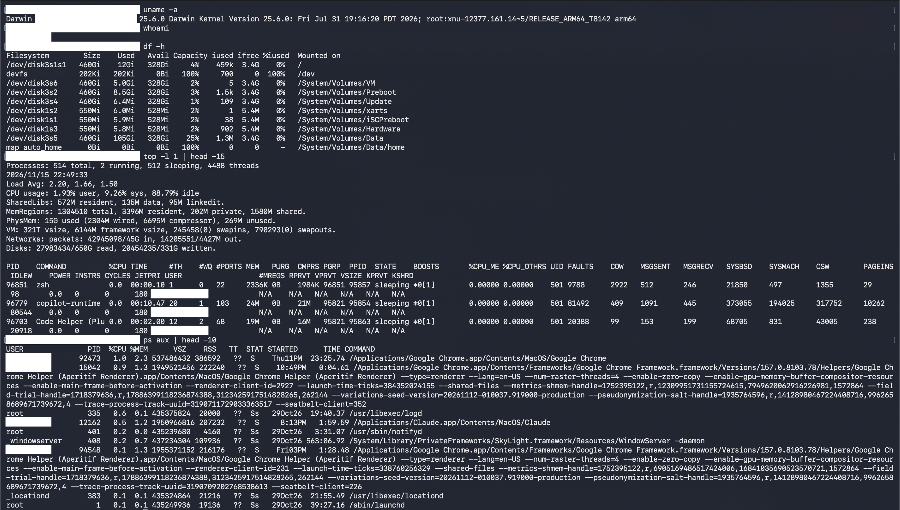

# Mission 3 — Understand the operating system

## 1. Task / objective
Explore the OS, processes, storage, paths and permissions, and describe OS responsibilities.

## 2. Work completed
Ran system-information commands (usernames and device names redacted), viewed processes, compared absolute and relative paths, and read file permissions.

### Task 3.1 - Explore your operating system

| Information | Command | What it tells me | Observation |
|---|---|---|---|
| OS details | `uname -a` | OS name, kernel, architecture | It printed Darwin first, then a version number, then the chip type. The device name was my Mac's name, which is hidden for privacy concern |
| Account | `whoami` | Which user is logged in | It printed my account name, which is hidden for privacy concern |
| Storage | `df -h` | Total, used, free space | total size:460Gi    used:12Gi   available:328Gi |
| Activity | `top -l 1 \| head -15` (macOS) | CPU/memory use, busy processes | refer evidence |

### Task 3.2 - Understand processes

- What is a process?
A process is a program that is currently running.

-  What does the PID column represent?
The PID is the unique number the OS gives each process.

- Give two examples of processes that may be running on your computer.
84515 ttys000    0:00.27 -zsh
96851 ttys002    0:00.10 /bin/zsh -il

-  `ps aux \| head` -> List of processes with PID | It showed few processes with its PID 

### Task 3.3 -  Understand paths and permissions

An absolute path is the full address of a file or folder, starting from the root of the file system (/).

A relative path describes a location starting from the folder you are currently in, so it depends on where you are.

- Absolute path starts from the root (`/Users/[redacted]/digital-detective-XXXX`); relative path starts from where I am (`../mission-02-terminal`).

| Information | Command | What it tells me | Observation |
| Permissions | `ls -l README.md` | Permission letters, owner, size | `-rw-r--r--` |
- In `-rw-r--r--`, the owner has `rw-`: can read and write, cannot execute.

### Task 3.4 — Explain operating-system responsibilities

| Responsibility | Explanation | Example |
|---|---|---|
| Process management | Decides which program uses the CPU and when | Running a browser and music player together |
| Memory management | Gives programs RAM and keeps them separate | Chrome and VS Code each get their own memory |
| Device management | Controls hardware through drivers | Sending a document to a printer |
| File management | Organises, stores and finds files | Saving a file into a folder |
| User interface / shell | How the user talks to the OS | Desktop (GUI) or Terminal (CLI) |
| Security and permissions | Controls who can access what | Login password, file permissions |

## 3. Commands / tools used

uname -a , whoami , df -h , top -l 1 | head -15 , ls -l
ps aux | head , ls -l , pwd , cd 

## 4. My understanding

The OS manages processes, memory, devices, files and security so the computer works smoothly. These commands made me understand it practically.

## 5. Difficulties faced

I came across few new commands such as df, uname, and explored about them.

## 6. How I resolved them

I researched about few commands which I wasn't sure of, in online.

## 7. Evidence / files

This README, redacted screenshots.

## 8. Commit details
"Document operating system and file management" — pushed and verified.
